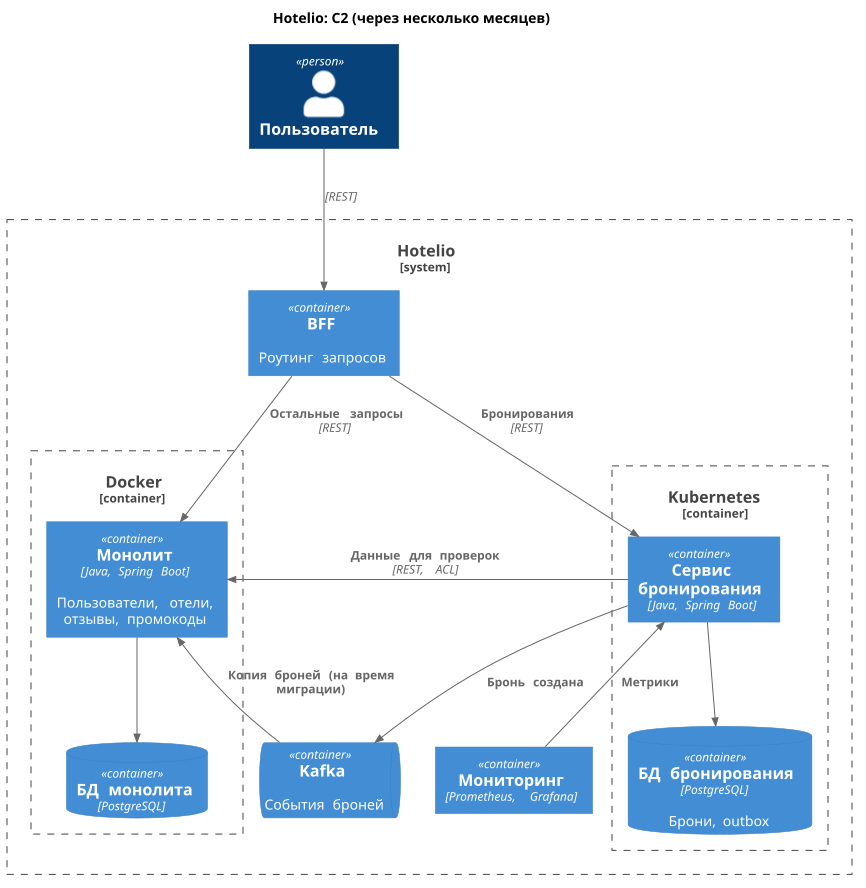

### **Название задачи:** Hotelio: начало миграции монолита на микросервисы
### **Автор:** Андрей Чигиринский
### **Дата:** 2026-10-16

### **Цель и проблема**
- Монолит (Java, одна БД) не масштабируется по частям, мешает независимой разработке и быстрым релизам. Основной трафик (нагрузка) идет на поиск отелей и бронирование, причем пики именно на бронирование.
- ADR описывает целевое состояние через несколько месяцев: какой микросервис выносим первым и почему, как переходим к нему по Strangler Fig.

### **Функциональные требования**
| № | Действующие лица или системы | Use Case | Описание |
| :-: | :- | :- | :- |
| 1 | Пользователь, отели, отзывы | Поиск отелей | Поиск отелей по городу, сортировка по рейтингу, чтение отзывов на отель |
| 2 | Пользователь, бронирование, пользователи, отели, отзывы, промокоды | Создание брони | 1. Проверка пользователя (активен, не в черном списке). 2. Проверка отеля (работает, надежен по отзывам, есть места). 3. Цена (для VIP пользователей дешевле) минус скидка по промокоду. 4. Сохранение брони |
| 3 | Пользователь, бронирование | Просмотр броней | Список броней пользователя |

### **Нефункциональные требования**
| № | Требование |
| :-: | :- |
| 1 | Бронирование масштабируется отдельно от остальной системы (пики по нагрузке) |
| 2 | Миграция без простоя, с возможностью отката |
| 3 | Новая функциональность добавляется только в вынесенные сервисы, монолит не дорабатывается |
| 4 | Начато разделение БД |
| 5 | Ресурсы команды: 2 Java-разработчика, архитектор, фронтенд, DevOps, тестировщик |

### **Решение**

#### Проблемы текущей системы

- Сложность сопровождения из-за связности модулей, в том числе неявных связей:
    - Бронирование связано со всеми остальными модулями
    - Отели неявно связаны с отзывами и бронированием через производные поля (рейтинг, заполненность)
    - Промокоды имеют излишнюю связь с пользователями
- Нет возможности отдельного масштабирования сервисов
- Нет независимой разработки и CI/CD
- Универсальный REST без BFF
- Безопасность: можно получить все брони всех пользователей, просто не передав идентификатор пользователя при запросе бронирований (в целом отсутствует аутентификация)
- Сложность мониторинга ошибок бронирования (все бизнес-ошибки система возвращает как 500 статус)

#### Выбор первого модуля

Оцениваем модули бронирования, отелей и промокодов как кандидатов на вынос в первую очередь.
Оценка по каждому критерию выполняется по шкале 1-3.
Чем выше оценка по критерию, тем больше подходит модуль по данному критерию для выноса.

| Критерий | Вес критерия | Бронирование | Отели | Промокоды |
| :- | :-: | :-: | :-: | :-: |
| Связность с монолитом | 3 | 1 | 2 | 3 |
| Связность по БД | 2 | 3 | 2 | 2 |
| Нагрузка | 3 | 3 | 2 | 1 |
| Ценность для бизнеса | 3 | 3 | 3 | 2 |
| Риск при сбое | 3 | 2 | 2 | 3 |
| Развитие продукта (новые функции) | 2 | 3 | 2 | 1 |
| Трудоемкость выноса | 2 | 1 | 2 | 3 |
| **Итого** | | **41** | **39** | **39** |

Вначале выносим бронирования:
- Бронирования имеют наименьшую связность по БД (другие модули не читают бронирования).
- Нагрузка на бронирования уже является проблемой (пики нагрузки приходятся на бронирования). Для бизнеса это будет наиболее ценный выбор.
- Риски при выносе бронирований высоки, но компенсируются возможностью отката (переключение по Strangler Fig).
- Выглядит, что бронирование приоритетно с точки зрения развития продукта (найдены проблемы, требующие доработок: с безопасностью, неявными связями, мониторингом ошибок). При этом как цель было задано, что монолит нежелательно развивать.
- С точки зрения связности кода и трудоемкости выноса бронирования проигрывают отелям и промокодам, но по общей сумме выигрывают.

#### Целевое состояние (несколько месяцев)

[c2-to-be.puml](c2-to-be.puml)

- Одновременно с началом перехода к микросервисной архитектуре начинаем и осваивать Kubernetes на новом микросервисе. Монолит остается в Docker. Таким образом вначале выносим сервис бронирования со своей БД в Kubernetes. Получаем возможность масштабироваться в пик нагрузки.
- Данные пользователей, отзывов, промокодов, отелей микросервис берет по REST монолита через антикоррупционный слой (ACL). Разумно добавить кэш, чтобы в пик нагрузка целиком не уходила на монолит.
- Событие брони микросервис публикует в Kafka (outbox). Таким образом монолит может узнать о бронях. Событие брони нужно для миграции бронирований в микросервис (подробнее в следующем разделе).
- При выносе бронирований из монолита переносим основную бизнес-логику без изменений (только закрываем дыру в безопасности), но добавляем возможность отличать бизнесовые ошибки от сбоев (коды ответов и метрики) для возможности реализации мониторинга для микросервиса. Мониторинг (Prometheus, Grafana) должен быть готов до переключения трафика на микросервис.
- Перед монолитом и первым микросервисом ставим BFF (роутит запросы к бронированию в микросервис, остальное в монолит).
- Другие сервисы на первом этапе не выносим из-за ограниченных ресурсов команды: Java-разработчики будут заняты на микросервисе бронирований, DevOps на k8s, фронтендер на BFF.

#### План миграции (Strangler Fig)

Подготовка и реализация.
- Готовим k8s инфраструктуру для нового микросервиса.
- Реализуем микросервис бронирований, собственную БД микросервиса, ACL, мониторинг (в т.ч. доработку обработки ошибок в сервисе).
- Реализуем BFF (вначале весь трафик идет на монолит).
- Учим монолит читать события бронирований из Kafka и записывать брони в старую таблицу в БД монолита (реальных событий еще нет).

Переключение.
- Переводим запись бронирований на микросервис через BFF (`POST /api/bookings`). Монолит начинает читать события из Kafka и синхронизировать в свою БД (это важно, т.к. чтение бронирований осталось через монолит). После этого переносим старые брони в БД микросервиса. В случае проблем откатываемся на запись броней в монолит, исправляем проблемы, повторяем процесс.
- Переводим чтение бронирований на микросервис через BFF (`GET /api/bookings`). После стабилизации удаляем старые API и данные бронирований из монолита, Kafka консьюмер бронирований.

### **Альтернативы**
- Первыми вынести отели: меньше связей, чем у бронирований, тоже высокая нагрузка (поиск отелей). Но пики нагрузки сейчас на бронированиях. Можно вынести далее.
- Первыми вынести промокоды (или отзывы): минимальный риск и трудоемкость, но не решают ни одной критичной проблемы бизнеса - нагрузку и развитие бронирования.

**Недостатки, ограничения, риски**

- В момент, когда переключили запись бронирований на микросервис, а чтение еще не переключили (идет через монолит), новая бронь видна в списке с задержкой (eventual consistency), т.к. нужно, чтобы монолит прочитал событие о брони из Kafka.
- В пик часть нагрузки остается на монолите (данные для проверок при бронировании). Можно снизить риск добавлением кэша, в теории и монолит можно запустить в нескольких экземплярах.
- Гибридная инфраструктура (Docker и k8s): нужна сетевая связность между ними.
- Вне рамок осталось решение части проблем, не связанных с вынесением бронирований из монолита: излишние и неявные связи между модулями, аутентификация и т. д. Эти проблемы решаются на следующих этапах. Следующий шаг - планирование дальнейших этапов для решения данных проблем и достижения годовых целей в целом.
